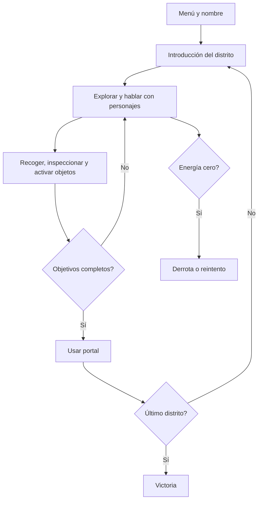

# Diseño algorítmico · Aventura 2D

## Bucle de juego

```text
iniciar ventana, fuentes, música y menú
mientras la ventana esté abierta:
    leer eventos: cierre, teclado y botones
    si hay partida y no hay pausa ni diálogo:
        actualizar temporizadores
        mover al jugador con subpasos y colisiones por eje
        mover centinelas entre sus extremos de patrulla
        detectar contacto con amenazas y peligros
    procesar notificaciones y animaciones
    dibujar mapa, personajes, objetos, diario y diálogos
    escalar imagen a la ventana y presentar
al salir: detener audio y liberar recursos
```

## Interactuar

```text
si existe diálogo: avanzar texto y terminar
si hay victoria o derrota: no actuar
buscar objeto más cercano a 51 píxeles o menos
rechazar si una pared corta el segmento hacia el objeto
si es personaje: activar misión y mostrar instrucciones
si no se habló con el personaje: solicitar conversación inicial
según tipo:
    mensaje: recoger si mochila vacía
    terminal: exigir mensaje inspeccionado y destino correcto
    forja: exigir tres fragmentos
    segundo factor: exigir forja y sello
    reporte: exigir tres estaciones desconectadas
    baliza: consumir un cristal
    habitante: exigir su baliza activa
    portal: exigir todos los objetivos; avanzar o ganar
marcar objetos completados y conceder su premio una sola vez
```

## Movimiento y daño

Se normaliza el vector de movimiento para que la diagonal no sea más rápida. El desplazamiento se divide en subpasos de hasta cinco píxeles; se comprueba el eje horizontal y después el vertical contra rectángulos de paredes. El impulso aumenta temporalmente la velocidad, sin omitir las colisiones.

Daño válido: energía menos uno, puntos menos 20 con mínimo cero, regreso al refugio y protección de 1,5 segundos. El reinicio restaura el estado de entrada al distrito y limpia sus objetivos. Los diálogos y la pausa congelan el mundo.



## Centinelas y guía contextual

Cada centinela tiene estado, temporizador de alerta, memoria de última posición y ruta. Se calcula visión por distancia y por intersección del segmento hacia el jugador con las paredes. Al detectar se espera 0,55 segundos; luego se persigue la última posición conocida mediante búsqueda en anchura sobre casillas, excluyendo paredes, peligros y refugio. La ruta se recalcula cada 0,3 segundos o cuando cambia la casilla de destino. Al perder el rastro se vuelve al origen. También se validan colisiones rectangulares en cada eje del enemigo.

guia_actual consulta objetivos, inventario e inspecciones para devolver el siguiente objeto y una instrucción concreta. ruta_guia calcula una ruta evitando obstáculos fijos y el renderizador dibuja hasta seis casillas siguientes. Los diálogos y la pausa detienen la simulación de amenazas. El tutorial T no consume llamadas.
