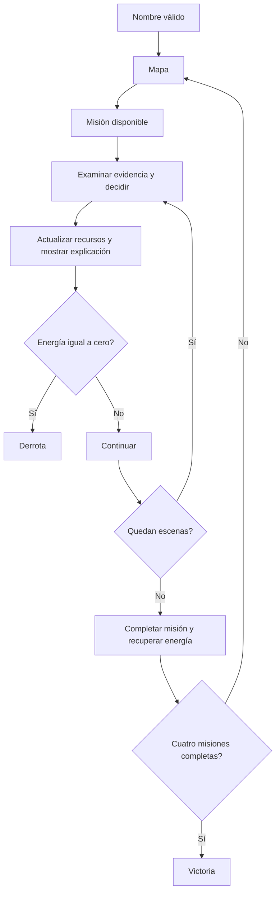

# Diseño algorítmico

```text
INICIAR PARTIDA(nombre)
    quitar espacios exteriores
    si longitud fuera de 1..24: rechazar
    puntos ← 0; energía ← 3; completadas ← lista vacía

INICIAR MISIÓN(índice)
    rechazar si terminó la partida, hay misión activa o índice no es siguiente
    guardar puntos, energía y tamaño del historial para reinicio
    paso ← 0

DECIDIR(opción)
    rechazar si no hay escena, la partida terminó o ya se decidió
    validar índice de opción
    si segura: puntos ← puntos + 100
    si riesgosa:
        puntos ← máximo(0, puntos − 50)
        energía ← máximo(0, energía − 1)
    registrar decisión y exigir lectura de explicación

CONTINUAR
    si energía = 0: mostrar derrota
    si no se decidió: rechazar
    avanzar escena
    si terminó misión:
        registrar misión completa; recuperar energía hasta máximo 3
        si cuatro completas: victoria
        si no: volver al mapa
    si no: mostrar siguiente escena
```



Invariantes: energía entre 0 y 3; puntos no negativos; una consecuencia por escena; progreso consecutivo; no avanzar antes de responder; no repetir misiones completadas. Reiniciar restaura el punto inicial de la misión, incluyendo su historial.
